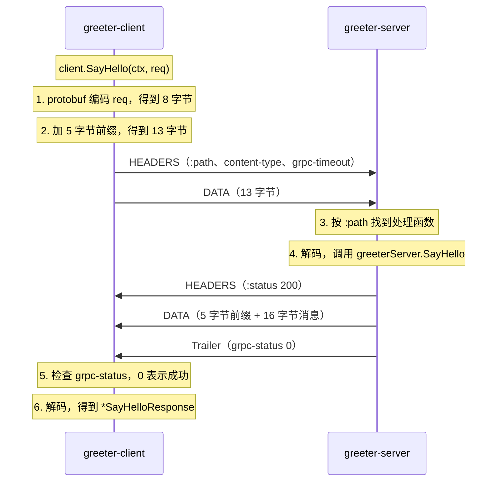

# 一元 RPC 调用链路复盘

本文拆开一次 `SayHello` 调用，说明它在网络上实际发送了什么。文中的字节和请求头都是实际抓取的数据，不是示意。

环境：Go 1.26.10、`google.golang.org/grpc` v1.85.0、`protoc-gen-go` v1.36.12、`protoc-gen-go-grpc` 1.6.2、`buf` 1.75.0。

## 结论

- gRPC 没有发明新的网络协议。它是 HTTP/2 加上一组约定。
- 每条消息由 5 字节前缀和 protobuf 编码的内容组成。
- protobuf 编码只记录字段编号，不记录字段名。
- 调用结果放在响应末尾的 Trailer 中（`grpc-status`），不看 HTTP 状态码。
- 业务代码只有 `greeterServer.SayHello` 这一个函数。其余工作由生成的代码、gRPC 库和 HTTP/2 完成。

## 项目结构

```
grpc-demo/
├── greeter-api/        # 契约：proto 和生成的 Go 代码
├── greeter-server/     # 服务提供方
└── greeter-client/     # 调用方
```

`greeter-server` 和 `greeter-client` 都用 `replace greeter-api => ../greeter-api` 引用同一份契约。所以两边的消息格式一定一致。

## 完整链路



整个调用在 1 个 HTTP/2 stream 中完成。下面 4 节分别说明请求头、消息前缀、protobuf 编码和 Trailer。

## 1 请求头：gRPC 在 HTTP/2 上的约定

`greeter-client` 发出的请求头如下。抓取方法见“复现方法”一节。

```
POST /greeter.v1.GreeterService/SayHello   (HTTP/2.0)
Content-Type: application/grpc
Te: trailers
Grpc-Timeout: 997935u
User-Agent: grpc-go/1.85.0
```

| 请求头 | 含义 |
| --- | --- |
| 方法 `POST` | gRPC 的所有调用都用 `POST` |
| 路径 | 格式是 `/{proto 包名}.{服务名}/{方法名}`。`package greeter.v1` 因此出现在 URL 中 |
| `Content-Type` | 固定为 `application/grpc` |
| `Te: trailers` | 声明调用方支持 Trailer。第 4 节说明 Trailer 的作用 |
| `Grpc-Timeout` | 调用方剩余的超时时间。单位 `u` 是微秒 |

server 收到请求后，用路径找到处理函数。`RegisterGreeterServiceServer` 登记的就是“路径到处理函数”的对应关系。

`Grpc-Timeout` 的值来自 client 代码中的 `context.WithTimeout(ctx, time.Second)`。这个值是 `997935u`，不是 `1000000u`。因为从创建 context 到发出请求，已经过去了约 2 ms。server 读取这个请求头，并把截止时间写进处理函数的 `ctx`。所以 server 能知道调用方还剩多少时间。

## 2 消息前缀：5 字节

请求体共 13 字节：

```
00                        压缩标志：1 字节，0 表示未压缩
00 00 00 08               消息长度：4 字节，大端序，值为 8
0a 06 74 6f 6e 67 68 73   消息内容：8 字节，protobuf 编码的 SayHelloRequest
```

响应体的格式相同：5 字节前缀加 16 字节消息。

长度前缀用于切分消息。在流式 RPC 中，1 个 stream 会连续传输多条消息。接收方读取长度，才知道每条消息在哪里结束。

## 3 protobuf 编码：只有编号，没有字段名

`SayHelloRequest{Name: "tonghs"}` 编码后是 8 字节：

```
0a                  tag：(字段编号 1 << 3) | 类型 2 = 0x0a
06                  长度：6 字节
74 6f 6e 67 68 73   "tonghs" 的 UTF-8 字节
```

类型 2 表示“长度 + 内容”。`string`、`bytes` 和嵌套 message 都用这个类型。

从编码结果可以得出 2 点：

- 数据中没有字段名 `name`，只有编号 `1`。所以字段名可以修改。字段编号发布后不要修改，也不要复用。
- 编码很紧凑。内容相同的 JSON `{"name":"tonghs"}` 有 17 字节。

`SayHelloResponse{Message: "Hello, tonghs!"}` 编码后是 16 字节：

```
0a 0e 48 65 6c 6c 6f 2c 20 74 6f 6e 67 68 73 21
```

`0e` 表示内容长度是 14 字节。

## 4 Trailer：调用结果在最后发送

用 `buf curl -v` 调用时，响应分为 3 部分：

```
< HTTP/2.0 200 OK                    响应头
< Content-Type: application/grpc
{ [5 bytes data]                     响应体：前缀
{ [16 bytes data]                    响应体：消息
< Grpc-Status: 0                     Trailer
< Grpc-Message:
```

`HTTP/2.0 200 OK` 只表示 HTTP 层没有出错。调用结果看 Trailer 中的 `grpc-status`，`0` 表示 `OK`。

调用结果放在最后，是为了支持流式 RPC。server 可能先发出 100 条消息，在第 101 条时出错。这时响应头已经发出，只能在 Trailer 中报告最终状态。

gRPC 选择 HTTP/2，原因之一是 HTTP/1.1 对 Trailer 的支持不完整。

## 5 每一层由谁负责

| 层 | 负责者 | 需要手写的代码 |
| --- | --- | --- |
| 业务逻辑 | 开发者 | `greeterServer.SayHello` |
| 接口和 stub | `protoc-gen-go-grpc` 生成 | 无 |
| 消息编码和解码 | `protoc-gen-go` 生成，加上 protobuf 库 | 无 |
| 路由、消息前缀、状态码、超时传递 | `google.golang.org/grpc` 库 | 无 |
| 多路复用、流量控制 | HTTP/2 | 无 |

## 实验：只修改一侧的字段编号

这个实验验证第 3 节的结论：两端只按字段编号对应字段。

步骤：

1. 用 `go build` 编译 `greeter-client`，保留这个旧版本二进制文件。
2. 在 `greeter.proto` 中，把 `SayHelloRequest` 的 `name = 1` 改成 `name = 2`。
3. 在 `greeter-api/` 下执行 `buf generate`。
4. 重新编译并启动 `greeter-server`。
5. 用第 1 步的旧版本 client 调用 `SayHello`，参数是 `-name tonghs`。

结果：

```
client：Greeting: Hello, !
server：Received SayHello request: ""
```

调用没有报错，但是 `name` 变成了空字符串。原因如下：

- 旧版本 client 把 `"tonghs"` 编码为字段 1。
- 新版本 server 只读取字段 2。它把字段 1 当作未知字段，跳过这个字段。
- server 读不到字段 2，所以 `GetName()` 返回零值 `""`。

这类错误不会产生报错，只会让数据静默丢失。所以字段编号发布后不要修改。实验完成后，必须把编号改回 `1`，并重新执行 `buf generate`。

## 复现方法

### 查看 buf curl 的完整交互

1. 启动 server：在 `greeter-server/` 下执行 `go run .`。
2. 在 `greeter-api/` 下执行下面的命令：

```bash
buf curl -v --protocol grpc --http2-prior-knowledge \
  --schema proto \
  --data '{"name":"tonghs"}' \
  http://localhost:50051/greeter.v1.GreeterService/SayHello
```

参数说明：

- `-v`：输出请求头、响应头和 Trailer。
- `--http2-prior-knowledge`：不使用 TLS，直接用 HTTP/2 通信。
- `--schema proto`：读取本地 proto 文件。server 没有开启反射，`buf curl` 需要本地 proto 才能编码消息。

### 查看 grpc-go client 发出的请求头

`buf curl` 和 `greeter-client` 发出的请求头不完全相同。例如，`greeter-client` 设置了超时，所以会多发 `Grpc-Timeout`。要查看 `greeter-client` 的请求头，可以用一个 HTTP/2 server 代替 `greeter-server`，打印收到的请求：

```go
h := http.HandlerFunc(func(w http.ResponseWriter, r *http.Request) {
	fmt.Println(r.Proto, r.Method, r.URL.Path)
	for k, v := range r.Header {
		fmt.Println(k, "=", v)
	}
	body, _ := io.ReadAll(r.Body)
	fmt.Printf("body % x\n", body)
})
// h2c：不使用 TLS 的 HTTP/2
http.ListenAndServe("127.0.0.1:50051", h2c.NewHandler(h, &http2.Server{}))
```

这个 server 不返回 gRPC 响应。所以 client 会报 `Unavailable` 错误，这是预期结果。
